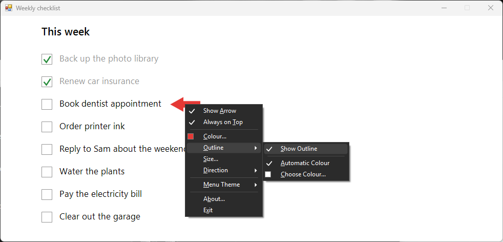
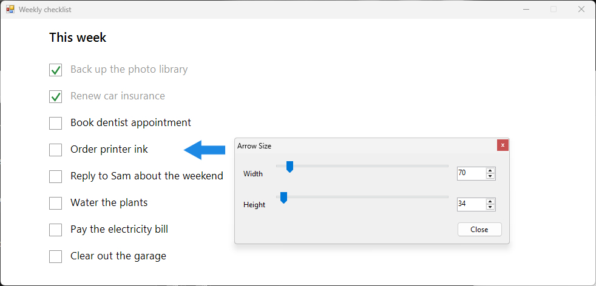

# Pointer-O-MATIC

A tiny, portable Windows app that puts an arrow on your screen, so you can keep your place in a list, a document, or anything else on the desktop.

> **100% AI-generated.** All of the code in this project was written by Claude (an AI by Anthropic), directed and tested by Michael Winn.





## Features

- **Always on top** of other windows (can be turned off)
- **Drag it anywhere.** Use the keyboard arrow keys to move it 1 pixel at a time (10 with Shift)
- **Any colour**, plus an optional outline in an automatic contrasting colour or one you choose
- **Live resizing:** width and height sliders update the arrow as you drag, and the tip stays where it's pointing
- **Four shapes:** Classic and Slim (with a tail), Triangle and Dart (without). Switching shape keeps the tip exactly where it was
- **Point in any direction:** right, left, up or down
- **Follow clicks:** the arrow can jump to wherever you last clicked, which is handy for keeping your place in a long list of links. It can sit a set distance to one side of the click, or stay in its column and only move up and down. You can make it move only when you hold a key of your choice while clicking, or only for clicks in one program (such as your browser), and turn following on and off from any program with a keyboard shortcut (Ctrl+Shift+Space, or one you choose)
- **Right-click menu** on the arrow, in a light or dark style, or matching Windows automatically
- **Tray icon** with the same menu. Left-click it to bring the arrow back to the front, or hide the arrow and show it again from the tray
- **Fully portable:** a single small `.exe`. No installer, no AppData folder, nothing written to the registry. All settings are saved to an `.ini` file next to the `.exe` as soon as you change them

## Download and run

1. Download the latest zip from the [Releases](../../releases) page.
2. Unzip it anywhere, such as a folder or a USB stick.
3. Run `Pointer-O-MATIC.exe`.

It needs Windows 10 or 11. It uses the .NET Framework 4 that is already built into Windows, so there is nothing else to install.

`Pointer-O-MATIC.ini` is created next to the `.exe` the first time it runs. To start fresh, close the app and delete that file.

## Using it

| To... | Do this |
| --- | --- |
| Move the arrow | Drag it with the left mouse button, or click it and use the arrow keys |
| Change anything | Right-click the arrow (or the tray icon) |
| Resize | Right-click → **Size...** and drag the sliders |
| Find a hidden arrow | Left-click the tray icon |
| Quit | Right-click → **Exit** |

Windows 11 puts new tray icons in the **^** overflow area. To keep it visible, drag it onto the taskbar.

### Follow Clicks

Right-click → **Follow Clicks** → **Enabled** makes the arrow move each time you click somewhere else on screen.

Press **Ctrl+Shift+Space** in any program to turn Follow Clicks on or off. A short "Follow Clicks: On" or "Off" note appears by the arrow, and the program you're using keeps the focus. If the arrow is hidden, turning following on shows it again. To use a different shortcut, choose **On/Off Shortcut...** and press the keys you want, such as Ctrl+Alt+F or F8. **No Shortcut** turns the shortcut off. A key on its own, such as Space, works too, but while the app is running that key stops doing its normal job in every other program, so the app asks you to confirm. If another program already uses the shortcut, the app tells you and you can pick another one.

- **Move when I...** chooses which click moves the arrow:
  - **Left-click:** every click moves it, including clicks on the browser's Back button, tabs and the scrollbar.
  - **Ctrl + left-click** or **middle-click:** these open a link in a new tab in most browsers, so the arrow only moves when you open a link that way.
  - **Hold a key + left-click:** the arrow only moves when you hold your chosen key while clicking. The click still works normally, so a link opens in the same tab. Pick the key with **Choose Key...** (Q by default). Letter keys are also sent to the page, so they can type into a text box or trigger a site's keyboard shortcuts. Keys that don't type anything, such as **F2**, **Scroll Lock** or **Insert**, avoid that.
- **Only In** makes the arrow follow clicks in one program only. It lists the programs that have windows open, such as Vivaldi or Notepad++. Pick one, and clicks in every other program are ignored. **Any Window** turns the limit off. The lock is by program, not by window, so it covers all of that program's windows and still works after you restart the program. If the chosen program isn't open, the menu shows it as "(not open)".
- **Move the arrow...**
  - **Beside the click:** the arrow's tip sits a set distance to one side of the click. Set the side and distance in **Offset...**, and the arrow updates live as you change them. The arrow keeps the direction set in the **Direction** menu. The distance is measured from where you clicked, not from the end of the link.
  - **Up/down only:** the arrow stays in the column where you put it and only moves to the height of the click. This is ideal for a list of links of different lengths: put the arrow just to the right of the list once, and it follows you down.
  - **Left/right only:** the same idea for a horizontal row.

Clicks on the arrow itself and drags (selecting text, scrolling) are ignored. The arrow marks a place on the *screen*, so if you scroll the page it stays where it is until your next click.

## Settings file

Everything lives in `Pointer-O-MATIC.ini`. You can edit it by hand while the app is closed:

```ini
[Arrow]
X=1247
Y=678
Width=60
Height=30
Colour=#FF0000
Outline=1
OutlineColour=Auto        ; Auto, or a colour like #FFFF00
AlwaysOnTop=1
Direction=Right           ; Right, Left, Up or Down
Shape=Classic             ; Classic, Slim, Triangle or Dart
[Menu]
Theme=System              ; System (match Windows), Light or Dark
[Follow]
Enabled=0
Trigger=LeftClick         ; LeftClick, CtrlClick, MiddleClick or KeyClick
Key=Q                     ; key to hold for KeyClick (e.g. Q, F2, Scroll, Insert)
ToggleKey=Ctrl+Shift+Space ; shortcut that turns following on/off (e.g. Ctrl+Alt+F, F8, or None)
OnlyApp=vivaldi.exe       ; only follow clicks in this program (empty = any window)
OnlyAppName=Vivaldi       ; the name shown in the menu
Mode=Beside               ; Beside, UpDown or LeftRight
Side=Right                ; Right, Left, Above or Below (for Beside)
Distance=20               ; pixels from the click (for Beside)
[CustomColours]
List=...                  ; custom colours saved from the colour picker
```

When the theme is set to *System*, the app reads Windows' light/dark mode setting so the menu can match it. It never writes to the registry.

## Building from source

The source is a single C# file, [`src/PointerOMatic.cs`](src/PointerOMatic.cs). It builds with the C# compiler that comes with Windows, so you don't need Visual Studio:

```powershell
powershell -ExecutionPolicy Bypass -File build.ps1
```

This creates `Pointer-O-MATIC.exe` in the project folder and a release zip in `dist/`.

## Licence

Released under the [MIT License](LICENSE). You're free to use, copy, modify and share it.
